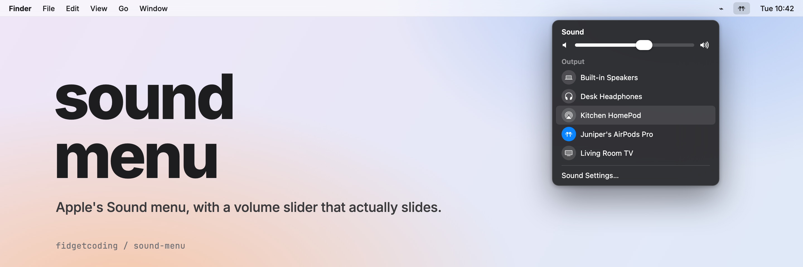
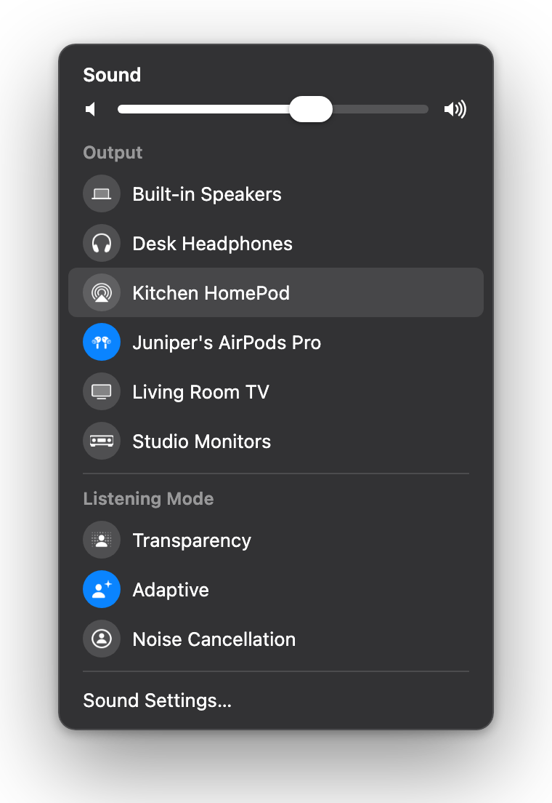

<a id="top"></a>



# sound-menu

**The macOS Sound menu, rebuilt in Hammerspoon, with a volume slider you can actually drag.**

<p align="center"></p>

## Why I made it

Hammerspoon's menu bar menus can't hold a slider, so my first version had a submenu of volume steps: 10%, 20%, 30%, click, click, click. I wanted Apple's menu. So the click now opens a small popover styled like Apple's Sound menu, slider and all, and it leaves out the virtual audio devices that clutter my list.

## What it does

- **Volume slider** that stays in sync with your Mac's volume, even when you change it with the keyboard
- **Every output device**, one click to switch. Virtual devices (BlackHole, Zoom) are hidden from the list but keep working in every app
- **AirPods controls** (Listening Mode, Spatial Audio, Conversation Awareness), read from Control Center
- **A menu bar icon that matches what's playing**: headphones, AirPods, an audio interface, AirPlay or a display

## Install

1. Install [Hammerspoon](https://www.hammerspoon.org) and give it Accessibility access (System Settings › Privacy & Security › Accessibility). The AirPods controls need it.
2. Copy `sound-menu.lua` and the `icons/` folder into `~/.hammerspoon/`.
3. Add this line to `~/.hammerspoon/init.lua`:

   ```lua
   require("sound-menu")
   ```

4. Reload Hammerspoon. To hide Apple's own Sound icon, turn it off in System Settings › Control Center › Sound.

## License

MIT. See [LICENSE](LICENSE).

---

Built by [Nate Davidovich / Lorecraft](https://github.com/fidgetcoding)

[⤴ back to top](#top)
